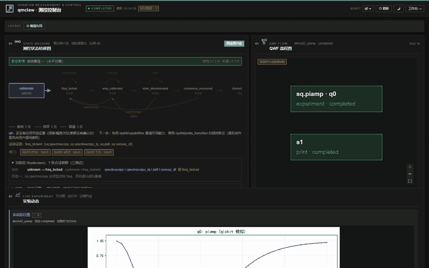
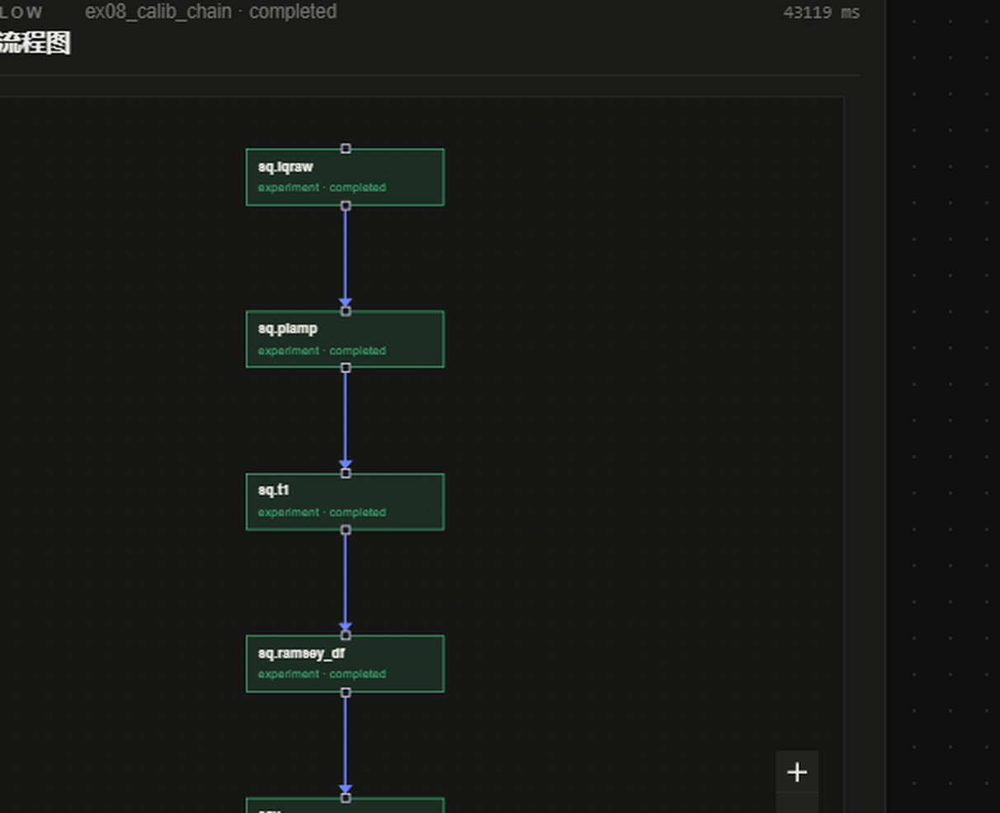

# QMClaw

**让 AI Agent 真正会标定量子比特 —— 靠一套可执行的规矩，而不是一段更长的提示词。**

量子实验的瓶颈从来不是"能不能调 API"，而是**每一步都可不可信**：状态从哪来、
下一步凭什么合法、数据算完怎么落成证据、出岔子时谁来收手。
QMClaw 把这件事拆成四层：Agent 只在规则允许的范围内动手，人始终握着闸门。

<p align="center">
  <a href="https://github.com/Secsix/QMClaw/blob/main/LICENSE">
    
  </a>
  <a href="https://github.com/Secsix/QMClaw/stargazers">
    
  </a>
  <a href="https://github.com/Secsix/QMClaw/actions/workflows/checks.yml">
    
  </a>
  <a href="https://github.com/Secsix/QMClaw/blob/main/.github/workflows/checks.yml">
    
  </a>
</p>

---

## 🎬 控制台配合 DSH 的测控现场



*上面这段录屏里，DSH 正在驾驶一次真实形态的测控循环，控制台 `/control` 同步呈现三件事：
① 测控状态转移图（当前状态与合法下一步）② 本次运行落成的 QWF 流程图 ③ 实验动态（本次运行的图像与指标）。*

**这段画面里发生了什么**：Agent 每一轮先问"这个比特现在是什么状态"，再问"从这个状态能往哪走"，
在合法边上选一个动作；动作先落成一份 QWF 工作流再提交执行；执行回来的指标换算成证据，
证据再决定状态是否推进。画面里的比特从 `unknown` 一路走到 `characterized`。

**QWF 不是只能跑一个实验**：录屏后段跑的是一条多节点标定链
（[`qwf_scripts/examples/08_calib_chain.qwf`](qwf_scripts/examples/08_calib_chain.qwf)），
控制台上的流程图按真实拓扑连线展示：



*`sq.iqraw` → `sq.piamp` → `sq.t1` → `sq.ramsey_df` → `say`：四个实验串成一条链，
节点之间是工作流本身的依赖边，不是画给人看的装饰。*
录屏中段驾驶循环每轮只提交**一个**实验，所以那几帧流程图只有一个节点 ——
那是驾驶层的粒度，不是工作流的极限。工作流语言本身支持分支、循环与读写数据集，
节点清单见 [`docs/QWF_NODES.md`](docs/QWF_NODES.md)。

> **诚实标注**：本段录屏跑在 **qiskit 模拟后端**上，证据来自演练通道（`source=loop`），
> **不是真机实测数据**。接上真机时这条链路一行不变，只是后端换了 —— 见
> [`docs/REAL_MACHINE.md`](docs/REAL_MACHINE.md)。

---

## 🧭 四条信条

**一 · 证据驱动，不靠自信。**
状态只能由"本次运行落下来的指标"换算得到；没有证据，状态就不许推进 —— 模型再确信也不行。
证据的来源、判据、有效期都记在台账里，可回溯、可复核。

**二 · 驾驶与执行分离。**
人（或 DSH 里的 Agent）负责决定"下一步做什么"，平台负责"安全地去做"。
状态机只认合法边：模板库里没有可用写法时，它把决策权交还给人（G3），不替人猜。

**三 · 实验先落成 QWF，执行只有一道门。**
任何实验都必须先变成一份工作流再提交，执行层不接受临时拼出来的代码。
于是"跑过什么"和"跑对没有"有了唯一可查的答案。

**四 · 降级要诚实。**
真机 → 模拟 → 历史回放是一条**有序策略**，不是一个开关。模拟跑出来的数据，汇报时永远写成演练数据，
不冒充实测；真机掉线时平台如实说"不可用"，不拿演示数据顶替。

---

## 🔁 一次真实的测控动线

标定一个比特只有一条入口：[`server/tools/measurement_loop.py`](server/tools/measurement_loop.py)。
每轮四步，缺一不可：

| 步骤 | 做什么 | 为什么不能省 |
|------|--------|--------------|
| 1 · 问状态 | 取当前状态与已有证据 | 不先问，就会基于过期状态行动 |
| 2 · 问路由 | 取合法边、候选动作、闸门状态 | 合法边是实验室的安全边界，不是建议 |
| 3 · 选动作 | 只在允许的动作里选；选不出来就**停下问人** | 决定权在驾驶层，不由模型私吞 |
| 4 · 换算落证 | 指标 → 证据（带来源与有效期）→ 状态 | 状态必须能被复现，不能靠嘴说 |

第 4 步的换算口径是固定的、可查的：态区分度 `separation > 1` 时归一化除以 2，
相干时间以秒落库时统一换算成微秒，等等。完整口径表与退出码契约见
[`docs/MEASUREMENT_LOOP.md`](docs/MEASUREMENT_LOOP.md)。

想先看一遍端到端的样子，可以跑演示剧本
[`server/tools/demo_control_console.py`](server/tools/demo_control_console.py)，
它按"扫频 → π 脉冲 → 态区分度 → T1 → Ramsey → XEB"六段推进，每段都真的提交一份 QWF。
手册见 [`docs/CONTROL_CONSOLE_DEMO.md`](docs/CONTROL_CONSOLE_DEMO.md)。

---

## 🗺️ 能力地图

| 你想做的事 | 用哪一块 |
|------------|----------|
| 让 Agent 学会平台怎么用 | [`skills/`](skills/README.md) —— 12 个以 `SKILL.md` 为入口的技能包 |
| 看着 Agent 干活 | `web/` 控制台：状态转移图、QWF 流程图、实验动态 |
| 真的把实验跑起来 | `server/` 网关 + 微服务：真机 / 模拟 / 离线三种后端 |
| 复查"这个结论凭什么" | 证据台账：演练证据（`source=loop`）与台账实测证据分开记 |
| 提交前先自检 | [`checks/`](docs/OPERATIONS.md) 17 项离线静态自检 + 3 项在线自检 |

---

## 🧱 分层只为分工

- **驾驭层** —— 人和 DSH 里的 Agent。问状态、问路由、选动作、担责任。
- **机制层** —— 状态机与路由。知道哪些边合法、哪些判据算数。
  改结构的权力在人手里（`server/config/state_machine.json`、`server/config/lab_criteria.json`）。
- **执行层** —— 工作流服务。所有实验以 QWF 提交，没有旁路。
- **证据层** —— 台账与演练证据。只认本次运行的指标，来源可追。

同一件事里，**规则先、模型后**：能被规则说清的（合法边、判据阈值、写闸门）一律规则先行，
模型只兜底规则没覆盖的新情况 —— 快了、也便宜了，而且每一步都能解释。

---

## 🚀 怎么开始

前置条件：Node.js ≥ 18、Python ≥ 3.10、Git。
**没有真机也能完整跑通** —— 后端会按 `lqcs → qiskit → offline_sim` 自动降级，
详见 [`docs/DEMO_NO_LQCS.md`](docs/DEMO_NO_LQCS.md)。

**A · 只装技能**（用 AI Agent，不跑平台）

```bash
git clone https://github.com/Secsix/QMClaw.git
cd QMClaw

# Claude Code
mkdir -p ~/.claude/skills
cp -R skills/_shared skills/qmclaw-* skills/qubit-* skills/quantum-* skills/lqms-* ~/.claude/skills/

# Codex
mkdir -p ~/.codex/skills
cp -R skills/_shared skills/qmclaw-* skills/qubit-* skills/quantum-* skills/lqms-* ~/.codex/skills/
```

重启 Agent 会话后直接用自然语言触发（"执行单比特校准工作流"、"怎么画 T1 拟合图"）。
详见 [`skills/README.md`](skills/README.md) 与 [`install.md`](install.md)。

**B · 跑起平台**（推荐）

```bash
git clone --recurse-submodules https://github.com/Secsix/QMClaw.git
cd QMClaw

cd server
npm install                                    # 网关
pip install -r python/requirements.txt          # Python 微服务
pip install -r python/requirements-qiskit.txt   # 可选：无真机时用 qiskit 模拟
cd ..
```

启动（**三个终端**，服务启停由人控制）：

```bash
# 终端 1：Python 微服务
cd server && python scripts/start_all_services.py --all   # :3003 quantum / :3004 analysis / :3005 agent ...

# 终端 2：Express 网关
cd server && npm run dev                                    # :3002

# 终端 3：前端控制台
cd web && npm install && npm run dev                        # :8081
```

打开 **http://localhost:8081**（前端默认连 `http://localhost:3002`，可用 `NEXT_PUBLIC_API_URL` 改）：

```bash
python checks/run_all_checks.py                # 17 项离线静态自检
curl http://localhost:3002/health              # 网关健康
```

**C · 接真机**（LabRAD）

装好 LabRAD 侧依赖、按实验室约定配好 session、写闸门由人显式打开。
提权步骤与故障排查见 [`docs/REAL_MACHINE.md`](docs/REAL_MACHINE.md)。

---

## 🔒 边界与安全

- **写闸门默认关闭**：`allow_execute` / `allow_set_params` 默认为 false，只在服务端强制；
  打开它必须是人的显式动作，并且留痕。
- **执行超时会标记 `stuck`** 并拒绝后续下发，须人工确认现场安全后再恢复。
- **不越界的三条红线**：模拟数据不冒充实测；真机掉线如实报"不可用"；
  单个后端异常就地转成"不可用 + 原因"，不连累别的服务。
- **该停就停**：模板库里没有可用写法时，测控循环会停下来等人给指令，而不是猜一个。
- **演练与台账分开**：模拟后端跑出来的证据一律标 `source=loop`，汇报时说明是演练，
  不得说成台账实测。

---

## 📄 文档索引

| 文档 | 内容 |
|------|------|
| [`install.md`](install.md) | 详细安装指南（技能安装、Python 包用法、MCP 配置、故障排查） |
| [`docs/ARCHITECTURE.md`](docs/ARCHITECTURE.md) | 平台架构与模块边界 |
| [`docs/OPERATIONS.md`](docs/OPERATIONS.md) | 日常运维：起停、配置、自检清单、排障 |
| [`docs/MEASUREMENT_LOOP.md`](docs/MEASUREMENT_LOOP.md) | 测控循环契约：四步流程、换算口径、退出码 |
| [`docs/STATE_GRAPH_PROFILES.md`](docs/STATE_GRAPH_PROFILES.md) | 状态图随芯片变化的配置方法 |
| [`docs/REAL_MACHINE.md`](docs/REAL_MACHINE.md) | 真机接入、写闸门、只读回归自检 |
| [`docs/DEMO_NO_LQCS.md`](docs/DEMO_NO_LQCS.md) | 无真机环境下的 qiskit / 离线演示 |
| [`docs/CONTROL_CONSOLE_DEMO.md`](docs/CONTROL_CONSOLE_DEMO.md) | 控制台演示剧本（六阶段） |
| [`docs/QWF_NODES.md`](docs/QWF_NODES.md) | QWF DSL 节点参考 |
| [`docs/qiskit_backend.md`](docs/qiskit_backend.md) | qiskit/Aer 本地模拟后端配置与用法 |
| [`docs/RUNTIME_DEPS.md`](docs/RUNTIME_DEPS.md) | 运行时依赖与安装校验 |
| [`docs/OPENQWF_SYNC.md`](docs/OPENQWF_SYNC.md) | 上游 OpenQWF 同步规则（门面 / vendor 指针） |
| [`docs/ADAPTER_GUIDE.md`](docs/ADAPTER_GUIDE.md) | 后端适配器接入指南 |
| [`docs/REPO_LAYOUT.md`](docs/REPO_LAYOUT.md) | 仓库结构与文件放位规则 |
| [`docs/QMClaw介绍及架构.md`](docs/QMClaw介绍及架构.md) | 中文版整体介绍 |
| [`docs/QMClaw_Skills_用户手册.md`](docs/QMClaw_Skills_用户手册.md) | 技能包使用手册 |
| [`AGENTS.md`](AGENTS.md) | 开发约定（提交节奏、日志、实验约定） |
| [`skills/README.md`](skills/README.md) | 技能索引与安装 |

---

## 📄 Paper

If QMClaw is useful for your research, please cite our paper:

**[QMClaw: A Scalable General-purpose Framework for Quantum Measurement and Control](https://arxiv.org/pdf/2609.04674)**

---

## 🤝 Contributing

Contributions are welcome! Please follow these steps:

1. **Fork** the repository
2. **Create** a feature branch (`git checkout -b feature/amazing-feature`)
3. **Commit** your changes (`git commit -m 'Add amazing feature'`)
4. **Push** to the branch (`git push origin feature/amazing-feature`)
5. **Open** a Pull Request

新增技能 / 新增文件的放位规则见 [`AGENTS.md`](AGENTS.md) 与 [`docs/REPO_LAYOUT.md`](docs/REPO_LAYOUT.md)；
提交前请跑一遍 `python checks/run_all_checks.py`。

---

## 📄 License

This project is licensed under the MIT License - see the [LICENSE](LICENSE) file for details.

---

## 🙏 Acknowledgments

- QMClaw framework developed by the QMClaw team
- Inspired by [nature-skills](https://github.com/Yuan1z0825/nature-skills)
- Built for the quantum computing community

---

## 📧 Contact

- **GitHub Issues**: [Issues](https://github.com/Secsix/QMClaw/issues)

---

## English summary

QMClaw is a general-purpose framework for quantum measurement and control. It pairs an
execution platform (an Express gateway, Python microservices, and a web console) with a set of
reusable Agent instruction bundles centred on `SKILL.md`. Its core idea is simple: let the Agent
act only inside rules a human can audit. Each measurement round asks for the qubit state, asks
which transitions are legal, picks an action from the allowed set — and stops for a human when no
template fits. Every experiment is submitted as a QWF workflow, and every state change is derived
from the metrics of that run, never from assertion. Hardware access degrades honestly along an
ordered policy (real instrument → simulator → recorded replay), and simulated results are always
labelled as drill evidence rather than measurements.

---

<p align="center">
  Made with ❤️ for the quantum computing community
</p>
